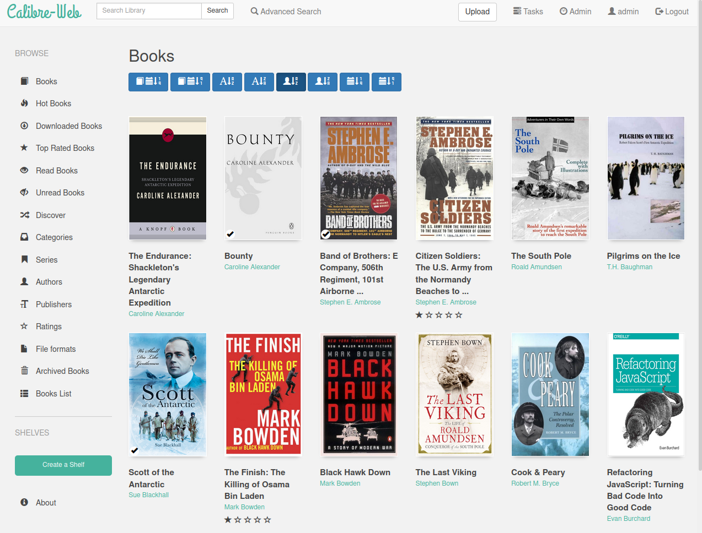

# Calibre-Web

Self-hosted ebook library — browse, search, read and download the ebooks in your own Calibre library from any browser or e-reader. Books live in a real Calibre database (`metadata.db`) with covers, authors, series, tags and ratings; the web UI adds an OPDS feed for e-reader apps, Kobo sync, upload and in-browser reading. No per-book fees, no cloud account, your library stays yours.

*Screenshot from the upstream Calibre-Web wiki ([janeczku/calibre-web](https://github.com/janeczku/calibre-web), GPL-3.0).*

## Source Repository

[https://github.com/INAPP-Mobile/calibre-web](https://github.com/INAPP-Mobile/calibre-web)

## Deploy and Host

Click **Deploy on Railway** above. One field on the deploy form: the admin password (generated for you). On first run, open the public URL and log in as `admin` with that password — the library is already set up with an empty Calibre database, so there is no setup wizard. Upload an EPUB and it appears in the library. No companion database, no build step.

## Why Deploy

- **Your books, your server.** The library is a standard Calibre `metadata.db` on a Railway volume — open it in Calibre desktop any time, back it up, or move it anywhere.
- **Reads anywhere.** The OPDS feed works with KOReader, Moon+ Reader and other ebook apps; Kobo devices sync directly; the built-in reader opens EPUBs in the browser.
- **Full library management.** Upload, edit metadata, manage shelves, rate books, and search across titles, authors, series, tags and publishers.
- **Share carefully.** Create additional users with their own shelves and visibility rules, or keep it a single-admin personal library.
- **Lightweight.** A single Python service with SQLite — no database server, no worker, no build step.

## Common Use Cases

- Personal ebook library you can reach from any device, without a cloud ebook account
- Family library: one server, separate users and shelves per reader
- Kobo sync server for a household of e-readers
- OPDS source for KOReader / Moon+ Reader on a phone or tablet
- A Calibre library that survives a laptop reinstall — the database lives on the server

## Configuration

| Variable | Default | What it does |
|---|---|---|
| `CW_ADMIN_PASSWORD` | `${{secret(16)}}` (deploy form) | Password for the `admin` account. Set once on first boot; change it later in the UI and it stays changed. |
| `CALIBRE_PORT` | `$PORT` (derived on boot) | Port the app listens on — Railway's injected port. The stored setting is also forced to this value on every boot. |
| `CALIBRE_DBPATH` | `/config` (baked in) | Where the app settings database (`app.db`) lives. |
| `CALIBRE_RECONNECT` | unset | Set to enable the public database-reconnect route under `/reconnect`. |
| `CALIBRE_LOCALHOST` | unset | Set to allow loading covers from localhost. |
| `CALIBRE_UNIX_SOCKET` | unset | Serve on a Unix socket instead of TCP (not used on Railway). |

Upstream docs: https://github.com/janeczku/calibre-web/wiki

### Deployment Dependencies

- **Runtime:** Python 3 + Flask, single service (LinuxServer image)
- **Plan:** Hobby or above; ~300 MB RAM at rest
- **Port:** Railway-injected `PORT` (Calibre-Web reads `CALIBRE_PORT`)
- **Persistence:** one Railway volume at `/data` (app settings in `/data/config`, Calibre library in `/data/books`)
- **Healthcheck:** `/login` (login page, unauthenticated)
- **Sessions:** login sessions use Flask-Login "basic" protection — the entrypoint forces `config_session=0`, because Railway's edge presents a different internal IP per connection and the upstream "strong" mode would log you out on every new connection.
