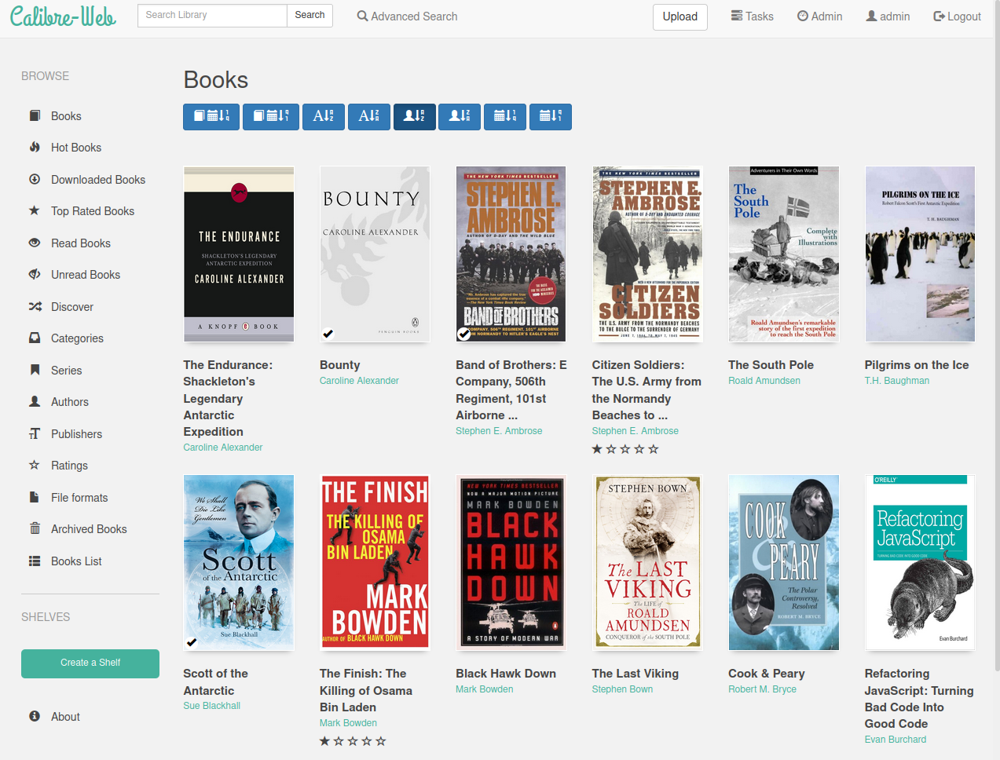

# Deploy and Host

Calibre-Web is a self-hosted ebook library — browse, search, read and download the ebooks in your own Calibre library from any browser or e-reader. Deploy it on Railway in one click: the library is a standard Calibre database on a persistent volume, the admin account is ready on first boot, and there is no setup wizard.

## About Hosting

Calibre-Web runs as a single service on Railway.

- **What gets deployed:** one Calibre-Web service (Python + Flask) on the pinned LinuxServer `calibre-web` 0.6.27 image.
- **Database:** embedded SQLite — app settings in `app.db`, books in a real Calibre `metadata.db`. No companion database service needed.
- **Persistence:** one Railway volume at `/data`, so settings and the library survive redeploys (app settings in `/data/config`, books in `/data/books`).
- **First run:** log in as `admin` with the generated password from the deploy form. An empty Calibre library is already seeded — upload an EPUB and it appears in the grid.

## Why Deploy

Your books live on your own server instead of a cloud ebook account. The library is a standard Calibre database you can open in Calibre desktop, back up, or move anywhere. The OPDS feed works with KOReader and Moon+ Reader, Kobo devices sync directly, and the built-in reader opens EPUBs in the browser. Upload, edit metadata, manage shelves and search across titles, authors, series, tags and publishers — all in a single lightweight service with no database server to run.

## Common Use Cases

- Personal ebook library reachable from any device, without a cloud ebook account
- Family library: one server, separate users and shelves per reader
- Kobo sync server for a household of e-readers
- OPDS source for KOReader / Moon+ Reader on a phone or tablet
- A Calibre library that survives a laptop reinstall — the database lives on the server

## Dependencies for Calibre-Web

| Setting | Value |
|---|---|
| Runtime | Python 3 + Flask, single service |
| Plan | Hobby or above |
| Port | Railway-injected `PORT` (Calibre-Web reads `CALIBRE_PORT`) |
| Persistence | One volume at `/data` (settings in `/data/config`, library in `/data/books`) |
| Healthcheck | `/login` (login page, unauthenticated) |
| Deploy form | One generated field (admin password) |
| Sessions | Flask-Login "basic" protection (entrypoint forces `config_session=0`); Railway's edge IP varies per connection, so the upstream "strong" mode would log users out on every new connection |

### Deployment Dependencies

- **Upstream:** [janeczku/calibre-web](https://github.com/janeczku/calibre-web) v0.6.27, GPL-3.0, pinned by digest
- **Admin account:** `admin` with the generated `CW_ADMIN_PASSWORD` from the deploy form, set once on first boot; change it later in the UI and it stays changed
- **Library:** upstream's own empty Calibre `metadata.db` is seeded into `/books` on first boot, so the app never shows the setup wizard; the stored library path and port are derived on every boot from the live environment
- **Formats:** EPUB, PDF, MOBI, AZW3, CBZ/CBR and more via the built-in reader and OPDS feed; KEPUB conversion uses the bundled `kepubify` binary
- **E-reader sync:** OPDS feed and Kobo sync work out of the box behind the Railway public domain; no base-URL setting is needed
